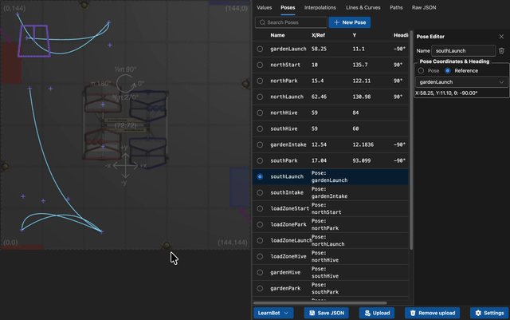

# An (in progress) PedroPath **v3** visualizer & editor



## How to use this thing:

0. Have a _non-Safari_ web browser installed. (Sorry: Safari is annoying, and I
   haven't bothered diagnosing why it's not rendering properly)
1. Install the [Bun](https://bun.com) or [NodeJS](https://nodejs.org) JavaScript
   runtime.
2. Either (easiest):
   1. Open up a command line inside Android Studio
   2. type `bunx @freik/pedroviz` (or `npx @freik/pedroviz`) and hit _`enter`_
      (because Android Studio puts you in the right directory automagically)
3. Or (a little more complicated):
   1. Navigate to the root of your robot source code directory from a command
      line
      - Windows: use Windows Terminal or the Command Host, and PowerShell or
        Command Prompt.
      - MacOS: use Terminal or iTerm (or WezTerm, or whatever terminal emulator
        and shell you want).
      - Linux: Use your favorite terminal emulator and shell. If you're using
        Linux, you don't need my help.
      - use `cd <folder location>` to get to where you put your source code.
   2. Type `bunx @freik/pedroviz` or `npx @freik/pedroviz` (depending on if you
      prefer Bun or NodeJS)
4. Advanced folks (who might use Bun or NodeJS for other things as well):
   1. Add it to your `package.json` dependency list: `bun add @freik/pedroviz`
      or `npm install @freik/pedroviz`
   2. Make a script to call `pedroviz`. If the `package.json` file isn't in your
      source repo root, add the location of your source as the second command.
      Something like this: `"pedro": "pedroviz ../BioBuzz"` and then you can
      call it by typing `bun pedro` or `npm run pedro` if you'd prefer!

The first time you use the app, it will take some time to download & install the
package. Once it's been installed, you no longer need to be connected to the
interwebs to use the visualizer. So you can be connected to your **_robot_** :D

You'll see something like this:

```text
🚀 🚀 🚀 🚀 🚀
Pedro Visualization application is running at http://localhost:58888

(Your browser should open automatically, but if it doesn't, open a browser
and go to that URL. The 'http://' is important, as the browser will not allow
the application to run without it.)

*********************************************
>>> Press Ctrl+C to stop the application. <<<
*********************************************
```

And then a browser window should open up. If it comes up with a 404, just
refresh the window. Depending on how fast your computer is, it can take a few
seconds. Once the application is visible:

1. Select your robot (if you have multiple TeamCode-like directories) at the
   bottom of the right side of the screen.
2. Select the Values, Poses, Curves, Interpolations, and Paths section to see
   your path descriptors.
3. [NYI} Select a Path or Curve to see a robot follow the path.

## Goals / What is this? / Why not just use the [PedroPath Visualizer](https://visualizer.pedropathing.com)?

The **goal** is for this to be a _local_ application that let's you vizualize
and edit PedroPath's. The _reasons_ for this as opposed to just using
[visualizer.pedropathing.com](https://visualizer.pedropathing.com/) are twofold:

1. (the simplest, dumbest reason) When you're connected to the bot (for
   deployment, debugging, or using a panel) you can't use the Visualizer, so you
   have to launch it, then switch your wifi. BOOO!
2. (The _real_ reason) This application integrates into your code. You don't
   have to import or export a file. This app just runs against your active code.
   If you want, you can edit the `assets/paths/pedropaths.json` file. IMO, it is
   much better than trying to keep a source file in sync with the visualizer
   yourself through horrible copy-paste shenanigans.

Basically: **_No more copying stuff back and forth!_** Just build your paths,
see what they look like, and push them to your robot pretty much immediately. No
more editing values with FTC Dashboard or Panels. Just click the 'upload' button
and it will push a file to your robot that will be loaded when you re-start your
opmode. The earlier version of this code actually parsed Java code. The problem
was that when a non-programmer started doing silly things (silly, but not wrong)
the parser stopped working. So it occurred to me: Just use a format that's easy
to parse in both directions. There's no real reason that this stuff should be
code, anyway.

## Current status

- Reading and editing values, poses, curves, and paths appears to work (though a
  little clunky in places).
- It's currently at near visualization parity with
  [PP Visualizer](https://visualizer.pedropathing.com)
- There are bugs in a few places, and the bot-side translation stuff is
  completely untested.

## Hey, Kevin, this doesn't work!

If your json doesn't show up properly, please send the file my way! I'm happy to
help diagnose issues you might be having! You can also create an issue. I'll do
my best to stay on top of them. I'm retired, so this is a priority for me (along
with all my other random projects around the house, and other coding projects,
but I do let FTC Robotics eat a lot of my frei time, because I love working with
FTC students...)

**Task TODO list, in some sort of order:**

- [ ] Get the Java JSON loader up & going!
  - [ ] Done, but untested! (Lives in my BioBuzz fork, currently)
- [ ] Global interpolation overrides need to be added
- [x] Save changes to the JSON file
  - [ ] Upload the file to the robot using ADB
  - [ ] Add a JSON version number, so that an ADB uploaded one will only
        override an older build asset
  - [ ] Allow a "Force new path version" thing? Dunno...
- [x] Animate the currently selected path or curve
  - [ ] Update the animation when the path changes
- [ ] Draw the interpolation arrows.
- [ ] Allow moving entire paths by grabbing them?
- [ ] Rename all ref's to a something when you rename the something.
- [ ] Prevent deleting items in use?
- [ ] Add an 'undo' buffer
- [ ] Highlight & display errors more obviously
- [ ] Get test coverage up to something tolerable (I've just been disabling PPv2
      failing tests, because I'm a bad engineer)
- [ ] Display JSON issues so users can see if they should fix their JSON, or
      send their JSON to me.
- [ ] Get this stuff working on Safari. I've enabled dev mode, and it looks like
      something with the ResizeObserver for the Canvas isn't working. Works fine
      on Firefox, Chrome, and Brave on Mac, Linux, and Windows (and Edge works,
      too).
- [ ] Document basic usage
- [ ] Enable "warning" lines: warn if the robot crosses a line on a path
- [ ] Make work with nodejs (`npx`) as well?
  - Kinda works, last time I checked...
- [ ] Support additional parts of the path builder
  - [x] multiple paths
  - [x] path headings (global and last)
  - [ ] max velocity (or, you know, any velocity/acceleration model for
        animation)
  - [ ] braking strength
  - [ ] tValues (Not sure what this would really look like...)
- [ ] Add a JSON _schema_ version number, for compatibility issues
- [ ] Change the Jotai atom structure to be much more granular. The single
      "symbol table" is a major source of re-rendering/flickering.

**Task List - done list:**

- [x] Read paths from JSON
  - [x] Specify robot dimensions (and other settings)
- [x] Allow detection of `field-dark.jpg` and `field-light.jpg` from the users's
      code for game-specific field backgrounds
- [x] Edit existing:
  - [x] Named values
  - [x] Named poses
  - [x] Named curves
  - [x] Named PathChains
- [x] Allow creation:
  - [x] Named values
  - [x] Named poses
  - [x] Named curves
  - [x] Named PathChains
- [x] Migrate to use a text file, instead of java source code for everything. V3
      suggests calling a function to get the paths. Make the function get the
      paths from the JSON file!
- [x] Allow editing points by dragging them on the canvas

## Development

This whole thing is built with [Typescript](https://www.typescriptlang.org/).
I'm using [Hono](https://hono.dev/) as a local web server (so it can work with
both Bun and Node), [React](https://react.dev/) as the core UI framework with
[Jotai](https://jotai.org/) for state management and
[FluentUI](https://storybooks.fluentui.dev/react) as the UI/controls toolbox.
None of these frameworks are too complicated to get started with, but each have
their own sets of weirdness. Feel free to reach out to me if you're trying to
understand the code, add a feature, or fix a bug.

The back end code is all served through `src/entry.ts` which serves up the
.ts/.tsx files packaged from the `src/client` subdirectory, and runs the stuff
packaged up from the `src/server` subdirectory on the backend.

To install dependencies:

```bash
bun install
```

To start a development server (with a sibling 'BioBuzz2026' repo):

```bash
bun dev
```

To bundle for production (only for Kevin, sorry):

```bash
bun prod:bundle
npm publish --access=public
```

### But, WHY????

Why did I build it this way, instead of using Java? Because I didn't want to
learn a new UI toolkit. I've been using React for a long time at this point.
It's cross-platform, and functional (in the mathematical/programming sense of
the word). Typescript is just flat out better than Javascript (fight me...), and
I switched to using [Recoil](https://github.com/facebookexperimental/Recoil)
when one of the engineers I supported while working at Facebook built in back in
2020 because I really hated all the boilerplate in Redux. Recoil is dead, but
Jotai was a public reimplementation that's still actively supported.

While a Microsoft employee, I had learned WinForms and WPF way way way back in
the day, but the various MVC/MVVM data-binding shenanigans just slowly sapped my
will to build UI's. Writing UI as functional, composable components makes my
brain so much happier than MVC or MVVM or any sort of forced "this is the UI,
and that's the data model" kind a crap.

I also have no interest in learning a different UI framework, particularly
something that's not going to be available everywhere I care about (Java on an
iPhone is not really a thing). So, it's TypeScript, and React. (I actually built
[a little C++ app framework](https://github.com/kevinfrei/cuark) that lets me
write much bigger, more complex things that use React + Typescript for the UI
across Linux, macOS, and Windows, and it's _not_ React Native: Maybe in the
footure I'll migrate to that framework? I dunno: `bunx @freik/pedroviz` is
embarassingly easy to do...).

Just know that I'm a grumpy old programmer who retired before Claude Code stole
the joy of coding if you're willing to pay $500+/month to light the planet on
fire. I love to write code. I _can_ code review (that's a primary role as a
mentor on FTC) but honestly, asking some miserable AI to create code when I'd
prefer to do it myself, and then have to code review that miserable AI's code
is...well, miserable. There's no joy to be had in helping the techno-fascists
pillage and destroy the planet, while **also** killing jobs that humans are
pretty good at, and that I actually happen to really enjoy. If you use Claude,
good on you. That does, however, mean I'm a better coder than you. Why? Because
[AI](https://theconversation.com/mit-researchers-say-using-chatgpt-can-rot-your-brain-the-truth-is-a-little-more-complicated-259450)
[rots](https://www.newscientist.com/article/2501634-ai-may-blunt-our-thinking-skills-heres-what-you-can-do-about-it/)
[your](https://www.bbc.com/future/article/20260417-ai-chatbots-could-be-making-you-stupider)
[brain](https://www.polytechnique-insights.com/en/columns/neuroscience/generative-ai-the-risk-of-cognitive-atrophy/).
